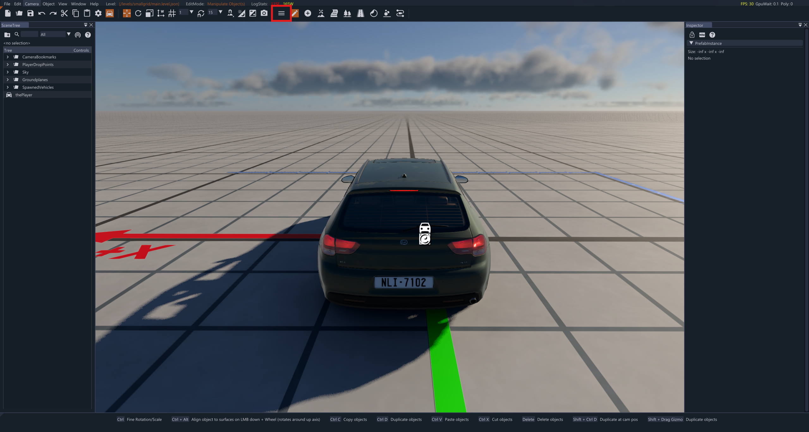
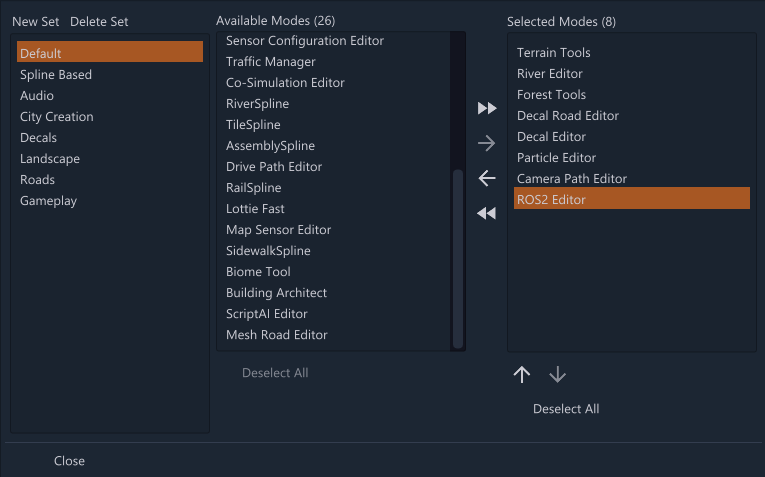
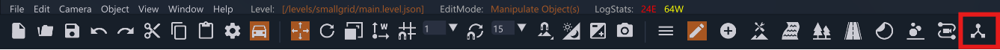

# BeamNG ROS2 Integration

## About

This repository contains packages to support the interoperability between [BeamNG.tech][1] and [ROS2][2].
BeamNG.tech is a driving simulation platform, suitable for commercial and academic use.
Inquiries for academic use can be made through our [registration form][3].
For inquiries regarding commercial use, contact us at <licensing@beamng.gmbh>.

## Table of Contents

- [BeamNG ROS2 Integration](#beamng-ros2-integration)
  - [About](#about)
  - [Table of Contents](#table-of-contents)
  - [Documentation](#documentation)
  - [Features](#features)
  - [Getting Started](#getting-started)
    - [Prerequisites](#prerequisites)
    - [Initial Setup](#initial-setup)
    - [Running BeamNG.tech with ROS2](#running-beamngtech-with-ros2)
  - [Usage](#usage)
  - [Compatibility](#compatibility)
  - [Compiling BeamNG ROS2 Integration](#compiling-beamng-ros2-integration)
  - [Troubleshooting](#troubleshooting)
    - [Known Issues](#known-issues)
  - [Contributions](#contributions)

## Getting Started

### Prerequisites

For using the BeamNG ROS2 integration, a BeamNG.tech build and a ROS2 environment are required.

BeamNG.tech and ROS have to be running on the **same machine** and the **same operating system** (Windows Subsystem for Linux is heavily discouraged due to performance limitations).

### Initial Setup
1. Download the latest Windows build of the BeamNG ROS2 integration from the [releases][4] page.
2. Extract the zip file to a directory of your choice.
3. If you are on Windows, copy the `.dll` file to the `Bin64` directory of your BeamNG.tech installation. If you are on Linux, copy the `.so` file to the `BinLinux` directory of your BeamNG.tech installation.

### Running BeamNG.tech with ROS2

In order to use use BeamNG with ROS2, you need to source the ROS2 environment and our ROS2 extension :
- Source your ROS2 environment as explained in the documentation of your ROS2 distribution.
- Source our ROS2 extension by running `install\local_setup.*`. Depending on your operating system and terminal, the following options are available :
  - Windows : `install\local_setup.ps1`, `install\local_setup.bat`
  - Linux : `install\local_setup.sh`, `install\local_setup.bash`, `install\local_setup.zsh`, `install\local_setup.ps1`
- Start BeamNG.tech with ROS2 by running `Bin64\BeamNG.drive.x64.exe -disable-sandbox`.
*Note : without the `-disable-sandbox` flag, the BeamNG ROS2 integration will not work correctly.*

## Usage

### Enable the ROS2 Editor
Once you have started BeamNG.tech with ROS2, you can use it via the World Editor interface :
- Load a map and a vehicle
- Open the World Editor (default : `F11`)
- Open the Set Editor :

- Go to Edit Sets
- Add the ROS2 Editor to the selected set:


### Use the ROS2 Editor
Once the ROS2 Editor is enabled, you can find it with the following icon :


On the ROS2 Editor window that opens, you have 5 sections :

1. On the very top, you can choose which `.dll` or `.so` file to use, this is useful if you want to use different versions of ROS2 with BeamNG.tech on the same machine.

Important : Versions of ROS2 are usually not inter-compatible, see [Compatibility](#compatibility) for more details.

2. The top section is a list of all vehicles in the simulation.
The name of each node corresponds to the id of the vehicle in the simulation.
On each line, you have multiple buttons, respectively :
- Center the camera on the vehicle
- Load a configuration file for this vehicle
- Save the current configuration of the vehicle
- Start the ROS2 node for this vehicle (or restart if it is already started)
- Stop the ROS2 node for this vehicle
When a node is started, the corresponding vehicle line will be highlighted in green.

3. Then the second section is a grid of all available sensors that can be added to the vehicle.
Simply click on the sensor you want to add and it will be added to the vehicle.

*Note : Changes made to the sensor configuration are not applied until the vehicle node is restarted.*

4. Then you can find the list of all sensors currently attached to the vehicle.
You can select a sensor in this list and change its parameters in the fourth section.

5. Finally, on the bottom you may find the parameters of the sensor selected in the third section.
You can change these parameters to modify the sensor configuration.
For sensors that have a physical position / rotation on the vehicle, you can also use the visual gizmos on the World Editor view to adjust them.
*Note : Changes made to the sensor parameters are not applied until the vehicle node is restarted.*


## Compatibility

To work correctly, BeamNG.tech and ROS2 have to be running on the **same machine** and the **same operating system**. Other configurations are not officially supported and may lead to major performance issues.

The BeamNG ROS2 integration is compatible with the following ROS2 distributions and operating systems:

| ROS2 Distribution | Windows 10 / 11 | Ubuntu 22.04 | Ubuntu 24.04 | Ubuntu 26.04 |
|---|---|---|---|---|
| Humble Hawksbill | Yes | Yes | No | No |
| Jazzy Jalisco | Yes | Not officially supported | Yes | No |
| Lyrical Luth | Yes | No | Not officially supported | Yes |


**Important : We strongly discourage the use of Windows Subsystem for Linux (WSL) for the BeamNG ROS2 integration due to important performance limitations.**

*Note : Other operating systems may work, but are not officially supported.*

## Compiling BeamNG ROS2 Integration

Although we provide pre-compiled binaries for the BeamNG ROS2 integration, you can also compile it yourself.

### Windows

#### Prerequisites
- Visual Studio 2019 x64 Native Tools Command Prompt for VS 2019 with CMake and Python installed
- ROS2 environment (see [Compatibility](#compatibility) for more details)

#### Steps
Here are the steps to compile the BeamNG ROS2 integration :

1. Clone the repository :
```bash
git clone https://github.com/BeamNG/beamng-ros2-integration.git
cd beamng-ros2-integration
git checkout cpp
```

2. Delete the `build`, `install` and `log` folders if they exist.

2. Start a Visual Studio 2019 x64 Native Tools Command Prompt for VS 2019

3. Source your ROS2 environment as explained in the documentation of your ROS2 distribution.

4. `cd` to the root of the repository and run the following commands :
```bash
colcon build --merge-install --packages-select beamng_msgs beamng_ros2
cd build/beamng_ros2
cmake --build . --config Release
```

5. Copy the `.dll` file from `build\beamng_ros2\Release` to the `Bin64` directory of your BeamNG.tech installation.

### Linux

#### Prerequisites
You will need a few packages to compile the BeamNG ROS2 integration, here is a one liner to install them all on Ubuntu :
```bash
apt-get install -y --no-install-recommends locales build-essential cmake git python3-colcon-common-extensions
```

#### Steps
Here are the steps to compile the BeamNG ROS2 integration :
1. Clone the repository :
```bash
git clone https://github.com/BeamNG/beamng-ros2-integration.git
cd beamng-ros2-integration
git checkout cpp
```
2. Delete the `build`, `install` and `log` folders if they exist.
3. `cd` to the root of the repository and run the following commands :
```bash
colcon build --merge-install --packages-select beamng_msgs beamng_ros2
cd build/beamng_ros2
cmake --build . --config Release
```
4. Copy the `.so` file from `build\beamng_ros2\Release` to the `BinLinux` directory of your BeamNG.tech installation.


## Troubleshooting

This section lists common issues with  BeamNG ROS2 Integration in particular. Since this
library is closely tied to BeamNG.tech and thus BeamNG.drive, it is also
recommended to consult the documentation on BeamNG.drive here:

[https://documentation.beamng.com/][5]

### Known Issues
These are issues that we are working on and there is no need to report them:

- Ultrasonic sensor is currently suffering a crashing issue due to a Vulkan issue.

## Contributions

We always welcome user contributions, be sure to check out our [contribution guidelines][6] first, before starting your work.

[1]: https://beamng.tech/
[2]: https://www.ros.org/
[3]: https://register.beamng.tech/
[4]: https://github.com/BeamNG/beamng-ros2-integration/releases
[5]: https://documentation.beamng.com/
[6]: https://github.com/BeamNG/BeamNG-ROS2-Integration/blob/main/CONTRIBUTING.md

