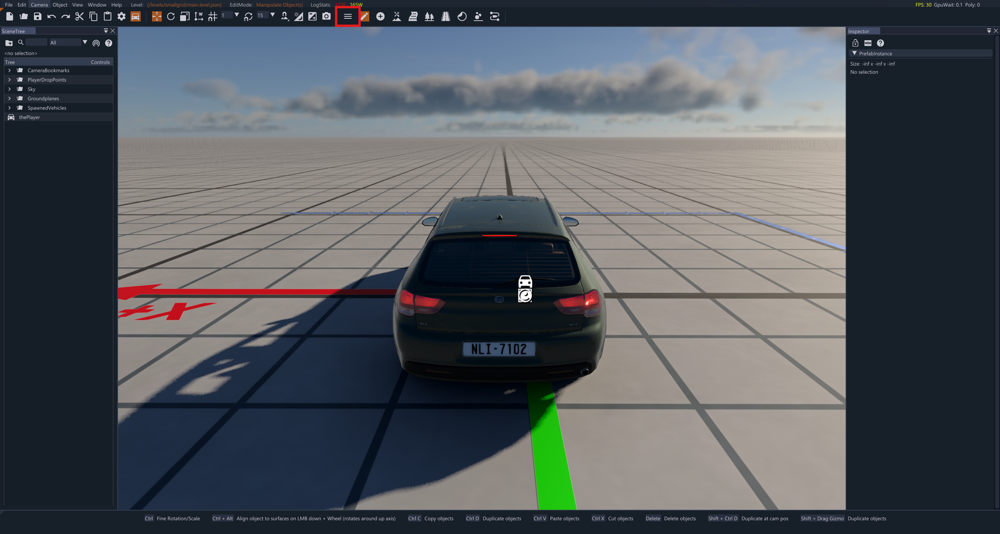
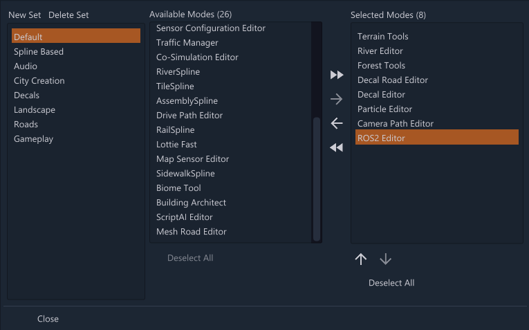
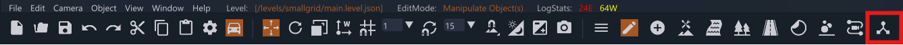

# BeamNG ROS2 Integration

## About

This repository contains packages to support the interoperability between [BeamNG.tech][1] and [ROS2][2].
BeamNG.tech is a driving simulation platform, suitable for commercial and academic use.
Inquiries for academic use can be made through our [registration form][3].
For inquiries regarding commercial use, contact us at <licensing@beamng.gmbh>.

## Table of Contents

- [BeamNG ROS2 Integration](#beamng-ros2-integration)
  - [About](#about)
  - [Table of Contents](#table-of-contents)
  - [Documentation](#documentation)
  - [Features](#features)
  - [Getting Started](#getting-started)
    - [Prerequisites](#prerequisites)
    - [Initial Setup](#initial-setup)
    - [Running BeamNG.tech with ROS2](#running-beamngtech-with-ros2)
  - [Usage](#usage)
  - [Lua API](#lua-api)
  - [Python API](#python-api)
  - [Compatibility](#compatibility)
  - [Compiling BeamNG ROS2 Integration](#compiling-beamng-ros2-integration)
  - [Troubleshooting](#troubleshooting)
    - [Known Issues](#known-issues)
  - [Contributions](#contributions)

## Getting Started

### Prerequisites

For using the BeamNG ROS2 integration, a BeamNG.tech build and a ROS2 environment are required.

BeamNG.tech and ROS have to be running on the **same machine** and the **same operating system** (Windows Subsystem for Linux is heavily discouraged due to performance limitations).

### Initial Setup
1. Download the latest Windows build of the BeamNG ROS2 integration from the [releases][4] page.
2. Extract the zip file to a directory of your choice.
3. If you are on Windows, copy the `.dll` file to the `Bin64` directory of your BeamNG.tech installation. If you are on Linux, copy the `.so` file to the `BinLinux` directory of your BeamNG.tech installation.

### Running BeamNG.tech with ROS2

In order to use use BeamNG with ROS2, you need to source the ROS2 environment and our ROS2 extension :
- Source your ROS2 environment as explained in the documentation of your ROS2 distribution.
- Source our ROS2 extension by running `install\local_setup.*`. Depending on your operating system and terminal, the following options are available :
  - Windows : `install\local_setup.ps1`, `install\local_setup.bat`
  - Linux : `install\local_setup.sh`, `install\local_setup.bash`, `install\local_setup.zsh`, `install\local_setup.ps1`
- Start BeamNG.tech with ROS2 by running `Bin64\BeamNG.drive.x64.exe -disable-sandbox`.
*Note : without the `-disable-sandbox` flag, the BeamNG ROS2 integration will not work correctly.*

## Usage

### Enable the ROS2 Editor
Once you have started BeamNG.tech with ROS2, you can use it via the World Editor interface :
- Load a map and a vehicle
- Open the World Editor (default : `F11`)
- Open the Set Editor :

- Go to Edit Sets
- Add the ROS2 Editor to the selected set:


### Use the ROS2 Editor
Once the ROS2 Editor is enabled, you can find it with the following icon :


On the ROS2 Editor window that opens, you have 5 sections :

1. On the very top, you can choose which `.dll` or `.so` file to use, this is useful if you want to use different versions of ROS2 with BeamNG.tech on the same machine.

Important : Versions of ROS2 are usually not inter-compatible, see [Compatibility](#compatibility) for more details.

2. The top section is a list of all vehicles in the simulation.
The name of each node corresponds to the id of the vehicle in the simulation.
On each line, you have multiple buttons, respectively :
- Center the camera on the vehicle
- Load a configuration file for this vehicle
- Save the current configuration of the vehicle
- Start the ROS2 node for this vehicle (or restart if it is already started)
- Stop the ROS2 node for this vehicle
When a node is started, the corresponding vehicle line will be highlighted in green.

3. Then the second section is a grid of all available sensors that can be added to the vehicle.
Simply click on the sensor you want to add and it will be added to the vehicle.

*Note : Changes made to the sensor configuration are not applied until the vehicle node is restarted.*

4. Then you can find the list of all sensors currently attached to the vehicle.
You can select a sensor in this list and change its parameters in the fourth section.

5. Finally, on the bottom you may find the parameters of the sensor selected in the third section.
You can change these parameters to modify the sensor configuration.
For sensors that have a physical position / rotation on the vehicle, you can also use the visual gizmos on the World Editor view to adjust them.
*Note : Changes made to the sensor parameters are not applied until the vehicle node is restarted.*

## Lua API

The same configuration the World Editor edits is available from Lua through `extensions.tech_ros_ROS2Api`. A sensor added from a script shows up in the editor, and the other way around. The editor does not need to be open.

Call it from the game-engine Lua console, a level script, or from vehicle Lua with `be:queueGameEngineLua(...)`.

```lua
extensions.load('tech_ros_ROS2Api')
local ros = extensions.tech_ros_ROS2Api

-- The binary name is searched for in the Bin64 or BinLinux directory. The .dll/.so extension is appended automatically.
-- nil reuses the library last loaded from the editor.
-- The library stays loaded until you restart the simulator, so switching ROS 2 versions needs a restart.
ros.loadBridge('ros2_windows_humble')

local vid = be:getPlayerVehicleID(0)

-- Scalar sensors. `fields` is a subset of the type's catalog; omit it to publish every field.
local _, electricsId = ros.addSensor(vid, 'Electrics', {
  fields = { 'throttle', 'brake', 'steering', 'wheelspeed', 'rpm', 'gear' },
})
ros.addSensor(vid, 'State')

-- Sensors with a pose. position / direction / up are vehicle-space coefficients, the same values the editor gizmo writes, not world coordinates.
local _, lidarId = ros.addSensor(vid, 'Lidar', {
  position = { 0.5, -0.3, 1.8 },
  direction = { 1, 0, 0 },
  up = { 0, 0, 1 },
  config = { update_rate_hz = 20 },
})

-- Nothing above is published until the node starts, later edits apply on the next start.
ros.start(vid)

-- Topics are /bng<vehicleId>/<sensorId>, for example /bng1234/Electrics_1
print(ros.getTopicName(vid, electricsId))
print(ros.getTopicName(vid, lidarId))
```

`addSensor` returns `ok, sensorId`. The id is generated exactly like the World Editor does it, `<Type>_<n>` (`Electrics_1`, `State_2`, `Lidar_3`, …), and it is the topic leaf. The type name is matched case-insensitively, so `'lidar'` and `'Lidar'` both produce `Lidar_<n>`.

`listSensorTypes()` returns every type `rosDefaults.json` defines, and `getSensorSchema(type)` returns the config keys, the pose keys and the scalar field catalog for one of them. The types are:


| Type                                                              | Message               | Notes                                    |
| ----------------------------------------------------------------- | --------------------- | ---------------------------------------- |
| `Electrics`, `GForces`, `State`, `Time`                           | scalar                | `fields` selects a subset of the catalog |
| `Damage`                                                          | `DamageSensor`        | event-driven, no pose                    |
| `GPS`, `AdvancedIMU`, `IdealRADAR`, `Roads`, `Powertrain`, `Mesh` | one blob message each | a pose where the type defines one        |
| `Lidar`, `Radar`                                                  | `PointCloud2`         | rendered, need a pose                    |
| `Camera`                                                          | `Image`               | rendered, needs a pose                   |
| `Ultrasonic`                                                      | `Range`               | rendered, needs a pose                   |


`setSensorFields(vehicleId, sensorId, nil)` publishes the full catalog again. It only applies to the four scalar types; other types have no field list to restrict.

### Reference

Functions that fail return `false` plus an error string, and log the same message.

**Bridge**


| Function              | Description                                                                                               |
| --------------------- | --------------------------------------------------------------------------------------------------------- |
| `loadBridge(path)`    | Load the bridge. `path` is a full path, a bare filename, or `nil` for the last one used.                  |
| `isBridgeLoaded()`    | Whether a library is loaded.                                                                              |
| `getBridgePath()`     | Full path of the loaded library, or `nil`.                                                                |
| `getLastBridgePath()` | Path remembered from the previous session. Only available once the editor has registered its preferences. |


**Vehicle nodes**


| Function                             | Description                                                                                                                                          |
| ------------------------------------ | ---------------------------------------------------------------------------------------------------------------------------------------------------- |
| `start(vehicleId)`                   | Publish the vehicle's stored config. Refuses when the bridge is not loaded or the vehicle has no sensors.                                            |
| `startWithConfig(vehicleId, config)` | Publish `config` directly and store it, so the editor shows what is running.                                                                         |
| `stop(vehicleId)`                    | Stop the node. Teardown is asynchronous: a `start` issued while it is in progress is queued, not dropped. `isStopping(vehicleId)` reports that wait. |
| `startAll()` / `stopAll()`           | Start every vehicle that has sensors, or stop every running node. Both return a count.                                                               |
| `isNodeActive(vehicleId)`            | Whether the node is currently publishing.                                                                                                            |
| `getNodeName(vehicleId)`             | `bng<vehicleId>`, also the default `frame_id`.                                                                                                       |
| `getNodeNamespace(vehicleId)`        | `/bng<vehicleId>`.                                                                                                                                   |
| `getTopicName(vehicleId, sensorId)`  | `/bng<vehicleId>/<sensorId>`.                                                                                                                        |
| `listVehicles()`                     | Ids of the vehicles currently in the scene.                                                                                                          |
| `listVehiclesInfo()`                 | Id, name, jbeam, whether its node is running, and how many sensors it has.                                                                           |


**Sensors**


| Function                                                        | Description                                                                                                                                          |
| --------------------------------------------------------------- | ---------------------------------------------------------------------------------------------------------------------------------------------------- |
| `addSensor(vehicleId, type, opts)`                              | Append a sensor with a generated `<Type>_<n>` id. `opts` may set `config` (merged over the defaults), `fields`, and `position` / `direction` / `up`. |
| `removeSensor(vehicleId, sensorId)` / `clearSensors(vehicleId)` | Remove one sensor, or all of them.                                                                                                                   |
| `listSensors(vehicleId)`                                        | The stored sensor list.                                                                                                                              |
| `getSensor(vehicleId, sensorId)`                                | The stored sensor plus the defaults entry it was created from.                                                                                       |
| `findSensorId(vehicleId, type)`                                 | Id of the first sensor of that type, or `nil`.                                                                                                       |
| `setSensorField(vehicleId, sensorId, path, value)`              | Set a dotted path, e.g. `'config.create.pos'`. `getSensorField` reads it back.                                                                       |
| `setUpdateRate(vehicleId, sensorId, hz)`                        | Set `config.update_rate_hz`. The minimum is 0.1 Hz.                                                                                                  |
| `setPublishMode(vehicleId, sensorId, mode)`                     | `'fixed'` uses the update rate, `'max'` publishes as fast as the sensor produces data.                                                               |
| `setSensorFields(vehicleId, sensorId, names)`                   | Restrict a scalar sensor to `names`. `nil` or `{}` restores the full catalog.                                                                        |
| `getSensorSchema(type)`                                         | Config keys, pose keys, field catalog and defaults for a type.                                                                                       |


**Configuration**


| Function                                                                | Description                                                                          |
| ----------------------------------------------------------------------- | ------------------------------------------------------------------------------------ |
| `getConfig(vehicleId)`                                                  | The stored config merged with the defaults: exactly what the next `start` publishes. |
| `getLiveConfig(vehicleId)`                                              | The config the node is publishing right now, or `nil` when it is stopped.            |
| `applyConfig(vehicleId, config)`                                        | Replace the stored config without starting the node.                                 |
| `validateConfig(vehicleId)`                                             | A list of problems. Empty means the config can launch.                               |
| `saveConfig(vehicleId, path)` / `loadConfig(vehicleId, path)`           | Write or read one vehicle's config as JSON. Files the editor saves load unchanged.   |
| `exportConfigString(vehicleId)` / `importConfigString(vehicleId, json)` | The same, as a string.                                                               |
| `saveAllConfigs(path)`                                                  | Write every vehicle's config to one file.                                            |


**Status**


| Function                      | Description                                                                                                                                                                                                 |
| ----------------------------- | ----------------------------------------------------------------------------------------------------------------------------------------------------------------------------------------------------------- |
| `getStatus(vehicleId)`        | Node name, namespace, bridge path, and one entry per published sensor with its topic and rate. While the node is stopped it reports what the next `start` would publish, including any validation problems. |
| `getAllStatus()`              | `getStatus` for every vehicle in the scene.                                                                                                                                                                 |
| `getEngineSensors(vehicleId)` | Engine-side sensors currently created for the vehicle.                                                                                                                                                      |


## Python API

BeamNGpy can control the same ROS2 extension through `bng.ros2`. This is a control API only: ROS2 sensor data is still published through ROS2 topics and is not streamed back through BeamNGpy.

```python
from beamngpy import BeamNGpy, Scenario, Vehicle

bng = BeamNGpy("localhost", 64256, home="C:/BeamNG.tech").open()

scenario = Scenario("smallgrid", "ros2_control")
vehicle = Vehicle("ego", model="etk800")
scenario.add_vehicle(vehicle, pos=(0, 0, 0), rot_quat=(0, 0, 0, 1))
scenario.make(bng)

bng.scenario.load(scenario)
bng.scenario.start()

# A bare name is resolved against Bin64 / BinLinux and the platform extension is appended.
bng.ros2.load_bridge("ros2_windows_humble")

electrics_id = bng.ros2.add_sensor(
    vehicle,
    "Electrics",
    fields=["throttle", "brake", "steering", "wheelspeed", "rpm", "gear"],
)
lidar_id = bng.ros2.add_sensor(
    vehicle,
    "Lidar",
    position=[0.5, -0.3, 1.8],
    direction=[1, 0, 0],
    up=[0, 0, 1],
    config={"update_rate_hz": 20},
)

# Nothing above is published until the node starts, and later edits apply on the next start.
bng.ros2.start(vehicle)

print(bng.ros2.get_topic_name(vehicle, electrics_id))
print(bng.ros2.get_topic_name(vehicle, lidar_id))
print(bng.ros2.get_status(vehicle))
```

`add_sensor` returns the generated sensor id, using the same `<Type>_<n>` format as the World Editor and Lua API (`Electrics_1`, `Lidar_2`, ...). Vehicle arguments accept either a BeamNGpy `Vehicle` object or the vehicle name/id string.

### Reference

Methods that fail raise a BeamNGpy `BNGError` with the error string returned by BeamNG.tech.

**Bridge**


| Method                   | Description                                                                                |
| ------------------------ | ------------------------------------------------------------------------------------------ |
| `load_bridge(path=None)` | Load the bridge. `path` is a full path, a bare filename, or omitted for the last one used. |
| `get_bridge_info()`      | Whether a library is loaded and the loaded library path.                                   |


**Vehicle nodes**


| Method                               | Description                                                                  |
| ------------------------------------ | ---------------------------------------------------------------------------- |
| `start(vehicle)` / `stop(vehicle)`   | Start/restart or stop the vehicle's ROS2 node.                               |
| `start_with_config(vehicle, config)` | Store and publish a full launch config.                                      |
| `start_all()` / `stop_all()`         | Start every configured vehicle, or stop every running node. Returns a count. |
| `is_node_active(vehicle)`            | Whether the vehicle node is currently publishing.                            |
| `is_stopping(vehicle)`               | Whether node teardown is still pending.                                      |
| `get_node_name(vehicle)`             | `bng<vehicleId>`, also the default `frame_id`.                               |
| `get_topic_name(vehicle, sensor_id)` | `/bng<vehicleId>/<sensorId>`.                                                |
| `list_vehicles()`                    | Vehicle names, jbeam, ROS active state and sensor count.                     |


**Sensors**


| Method                                                                                        | Description                                                                              |
| --------------------------------------------------------------------------------------------- | ---------------------------------------------------------------------------------------- |
| `add_sensor(vehicle, type, config=None, fields=None, position=None, direction=None, up=None)` | Append a sensor with a generated `<Type>_<n>` id.                                        |
| `remove_sensor(vehicle, sensor_id)` / `clear_sensors(vehicle)`                                | Remove one sensor, or all of them.                                                       |
| `list_sensors(vehicle)`                                                                       | The stored sensor list.                                                                  |
| `set_sensor_field(vehicle, sensor_id, path, value)`                                           | Set a dotted path, e.g. `config.create.pos`. `get_sensor_field` reads it back.           |
| `set_update_rate(vehicle, sensor_id, hz)`                                                     | Set `config.update_rate_hz`. The minimum is 0.1 Hz.                                      |
| `set_publish_mode(vehicle, sensor_id, mode)`                                                  | `fixed` uses the update rate, `max` publishes as fast as the sensor produces data.       |
| `set_sensor_fields(vehicle, sensor_id, names)`                                                | Restrict a scalar sensor to `names`. `None` restores the full catalog.                   |
| `list_sensor_types()` / `get_sensor_schema(type)`                                             | List known sensor types, or inspect config keys, pose keys and scalar fields for a type. |


**Configuration and status**


| Method                                                      | Description                                                                          |
| ----------------------------------------------------------- | ------------------------------------------------------------------------------------ |
| `get_config(vehicle)`                                       | The stored config merged with the defaults: exactly what the next `start` publishes. |
| `get_live_config(vehicle)`                                  | The config the node is publishing right now, or `None` when it is stopped.           |
| `apply_config(vehicle, config)`                             | Replace the stored config without starting the node.                                 |
| `validate_config(vehicle)`                                  | A list of problems. Empty means the config can launch.                               |
| `save_config(vehicle, path)` / `load_config(vehicle, path)` | Write or read one vehicle's config as JSON on the BeamNG.tech host.                  |
| `get_status(vehicle)`                                       | Node, bridge, validation and published-sensor topic status for one vehicle.          |


## Compatibility

To work correctly, BeamNG.tech and ROS2 have to be running on the **same machine** and the **same operating system**. Other configurations are not officially supported and may lead to major performance issues.

The BeamNG ROS2 integration is compatible with the following ROS2 distributions and operating systems:


| ROS2 Distribution | Windows 10 / 11 | Ubuntu 22.04             | Ubuntu 24.04             | Ubuntu 26.04 |
| ----------------- | --------------- | ------------------------ | ------------------------ | ------------ |
| Humble Hawksbill  | Yes             | Yes                      | No                       | No           |
| Jazzy Jalisco     | Yes             | Not officially supported | Yes                      | No           |
| Lyrical Luth      | Yes             | No                       | Not officially supported | Yes          |


**Important : We strongly discourage the use of Windows Subsystem for Linux (WSL) for the BeamNG ROS2 integration due to important performance limitations.**

*Note : Other operating systems may work, but are not officially supported.*

## Compiling BeamNG ROS2 Integration

Although we provide pre-compiled binaries for the BeamNG ROS2 integration, you can also compile it yourself.

### Windows


#### Prerequisites

- Visual Studio 2019 x64 Native Tools Command Prompt for VS 2019 with CMake and Python installed
- ROS2 environment (see [Compatibility](#compatibility) for more details)


#### Steps

Here are the steps to compile the BeamNG ROS2 integration :

1. Clone the repository :

```bash
git clone https://github.com/BeamNG/beamng-ros2-integration.git
cd beamng-ros2-integration
git checkout cpp
```

1. Delete the `build`, `install` and `log` folders if they exist.
2. Start a Visual Studio 2019 x64 Native Tools Command Prompt for VS 2019
3. Source your ROS2 environment as explained in the documentation of your ROS2 distribution.
4. `cd` to the root of the repository and run the following commands :

```bash
colcon build --merge-install --packages-select beamng_msgs beamng_ros2
cd build/beamng_ros2
cmake --build . --config Release
```

1. Copy the `.dll` file from `build\beamng_ros2\Release` to the `Bin64` directory of your BeamNG.tech installation.


### Linux


#### Prerequisites

You will need a few packages to compile the BeamNG ROS2 integration, here is a one liner to install them all on Ubuntu :

```bash
apt-get install -y --no-install-recommends locales build-essential cmake git python3-colcon-common-extensions
```


#### Steps

Here are the steps to compile the BeamNG ROS2 integration :

1. Clone the repository :

```bash
git clone https://github.com/BeamNG/beamng-ros2-integration.git
cd beamng-ros2-integration
git checkout cpp
```

1. Delete the `build`, `install` and `log` folders if they exist.
2. `cd` to the root of the repository and run the following commands :

```bash
colcon build --merge-install --packages-select beamng_msgs beamng_ros2
cd build/beamng_ros2
cmake --build . --config Release
```

1. Copy the `.so` file from `build\beamng_ros2\Release` to the `BinLinux` directory of your BeamNG.tech installation.


## Troubleshooting

This section lists common issues with  BeamNG ROS2 Integration in particular. Since this
library is closely tied to BeamNG.tech and thus BeamNG.drive, it is also
recommended to consult the documentation on BeamNG.drive here:

[https://documentation.beamng.com/](https://documentation.beamng.com/)

### Known Issues

These are issues that we are working on and there is no need to report them:

- Ultrasonic sensor is currently suffering a crashing issue due to a Vulkan issue.


## Contributions

We always welcome user contributions, be sure to check out our [contribution guidelines](https://github.com/BeamNG/BeamNG-ROS2-Integration/blob/main/CONTRIBUTING.md) first, before starting your work.